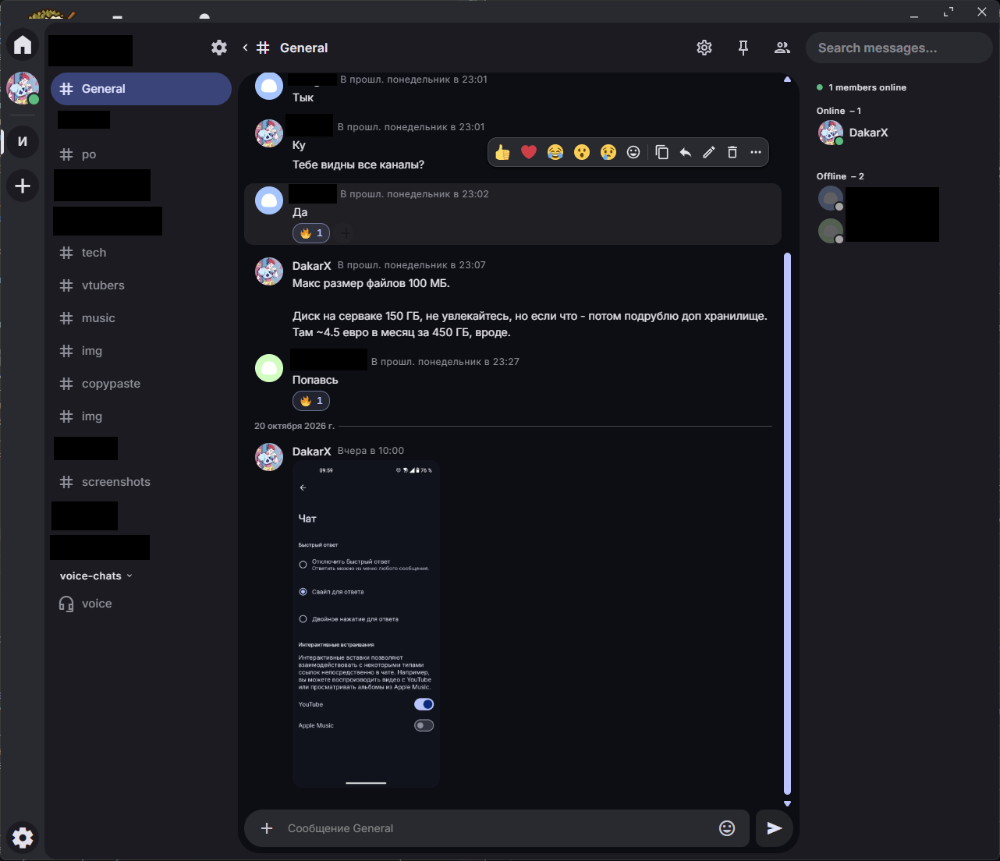
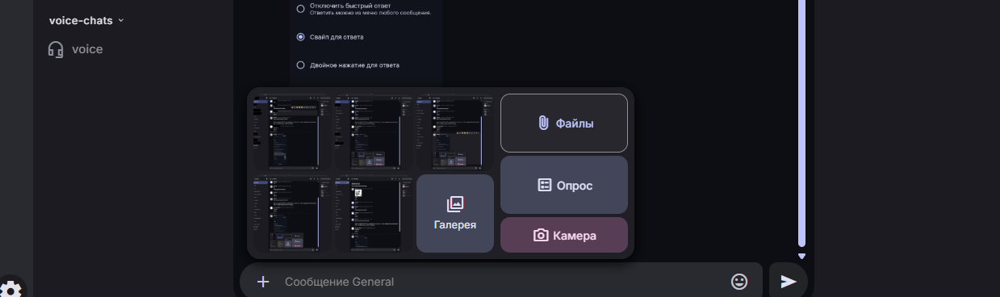

<p align="center">
  
</p>

<h1 align="center">dur.io для Windows</h1>

<p align="center">
  <b>Свой Discord: серверы, каналы, голос и демонстрация экрана — на сервере, который принадлежит вам.</b><br>
  <a href="https://github.com/DakarXYZ/durio-for-desktop/releases/latest">Скачать для Windows</a> ·
  <a href="https://github.com/DakarXYZ/durio-for-android/releases/latest">Android</a> ·
  <a href="https://github.com/DakarXYZ/durio-self-hosted">Поднять свой сервер</a>
</p>

**English summary.** **dur.io** is a self-hosted alternative to Discord: communities with text and voice
channels, roles, DMs and groups, screen sharing up to 1080p60, 100 MB uploads, polls, and end-to-end encryption
(beta) of DMs and groups. This is the Windows client (Electron). Its interface
([durio-for-web](https://github.com/DakarXYZ/durio-for-web)) ships inside the app and is never loaded from a
server, so a hijacked chat server cannot swap the code that holds the encryption keys. Install from
[GitHub Releases](https://github.com/DakarXYZ/durio-for-desktop/releases). Licensed under AGPL-3.0.



## Что такое dur.io

**dur.io** — мессенджер для своих сообществ, аналог и замена Discord. Всё привычное на месте: серверы с
текстовыми и голосовыми каналами, роли и права, личные сообщения и группы, реакции, ответы, закрепы, поиск. Разница
в том, **чьё это всё**: сервер dur.io ставится на ваш VPS по пошаговой инструкции
([durio-self-hosted](https://github.com/DakarXYZ/durio-self-hosted)), переписка и файлы лежат у вас, а не на чужой
платформе, — без рекламы, трекеров и чужих правил.

| | dur.io | Discord |
| --- | --- | --- |
| Где хранятся сообщения и файлы | на вашем сервере | на серверах Discord |
| Сквозное шифрование ЛС и групп | есть (бета) | нет |
| Вложения | до 100 МБ (настраивается на сервере) | 10 МБ без Nitro |
| Демонстрация экрана | до 1080p 60 fps бесплатно | 1080p60 — с Nitro |
| Реклама и трекеры | нет | есть |
| Исходный код | открыт (AGPL-3.0) | закрыт |

Что умеет:

- **Сообщества** — серверы, текстовые и голосовые каналы, категории, роли и права, приглашения одной ссылкой
  `https://<сервер>/invite/<код>` (и для регистрации, и для входа на сервер).
- **Голос и экран** — голосовые каналы и звонки, демонстрация экрана до 1080p 60 fps.
- **Сообщения** — ответы, реакции, правки, закрепы, вложения до 100 МБ, панель «+» с последними картинками из
  «Изображений» и «Снимков экрана», **опросы** (один или несколько ответов, с возможностью изменить голос или без).
- **Сквозное шифрование (бета)** личных сообщений и групп: сервер видит только шифротекст.
- **Несколько аккаунтов и серверов** в одном окне, как в Discord, только серверы — разные.
- **Везде**: Windows (этот репозиторий), [Android](https://github.com/DakarXYZ/durio-for-android) и браузер —
  каждый сервер dur.io сам отдаёт веб-версию по адресу `https://<сервер>/web/app/`.

<p align="center">
  
</p>

Автор и владелец — DakarX ([GitHub DakarXYZ](https://github.com/DakarXYZ)). Основано на
[stoatchat/for-desktop](https://github.com/stoatchat/for-desktop). dur.io — независимый форк и не связан ни с
проектом Stoat, ни с Discord; названия и логотипы Stoat и Discord — товарные знаки их владельцев.

## Установка

1. Откройте [Releases](https://github.com/DakarXYZ/durio-for-desktop/releases/latest) и скачайте
   `durio-setup.exe` и `SHA256SUMS` того же релиза.
2. Проверьте контрольную сумму: результат команды должен совпасть (без учёта регистра) со строкой `durio-setup.exe`
   в `SHA256SUMS`. Не совпало — не запускайте.

   ```powershell
   Get-FileHash .\durio-setup.exe -Algorithm SHA256
   ```

3. Запустите установщик. Он ставит приложение для текущего пользователя (`%LOCALAPPDATA%\durio`), прав
   администратора не нужно; данные — в `%APPDATA%\dur.io`.

Установщик пока **не подписан**, поэтому Windows предупредит:

- **SmartScreen** («Система Windows защитила ваш компьютер»): «Подробнее» → «Выполнить в любом случае».
- **Интеллектуальное управление приложениями** (Smart App Control, Windows 11) неподписанные приложения
  блокирует без кнопки «всё равно запустить»; если оно включено, установить dur.io можно только выключив его
  (Безопасность Windows → Управление приложениями/браузером) — решайте сами.
- Антивирус может отнестись к установщику с подозрением. Сверка `SHA256SUMS` подтверждает, что файл тот, что
  собрал CI этого репозитория.

**Обновления** приходят только из GitHub Releases этого репозитория (через публичный сервис обновлений Electron),
никогда с сервера чата: приложение скачает новую версию само и предложит перезапуск.

## Первый запуск и аккаунты

- **Адрес сервера.** Сервера по умолчанию нет: на первом экране введите адрес, который дал администратор,
  например `name.duckdns.org`. Приложение само найдёт API (`https://<адрес>/.well-known/stoat`).
- **Регистрация по приглашению.** На наших серверах зарегистрироваться можно только по приглашению — обычной
  ссылке `https://<сервер>/invite/<код>` из настроек сервера («Приглашения» или «Пригласить» у канала). Ссылка
  открывает в браузере страницу с адресом сервера и кодом; в приложении на экране регистрации вставьте ссылку
  целиком или код, после выбора имени приложение само откроет приглашение. Уже есть аккаунт — «+» →
  «Присоединиться к серверу». Если ссылка от другого сервера, приложение предупредит.
- **Несколько аккаунтов и серверов** — как в Discord: добавьте ещё аккаунт на том же или другом сервере и
  переключайтесь между ними. Токены, данные и ключи шифрования каждой пары «сервер + пользователь» хранятся
  отдельно.
- **Демонстрация экрана** — до 1080p 60 fps: Настройки → «Голос» → «Качество демонстрации» (если сервер
  разрешает меньше, приложение возьмёт лучшее доступное).
- Уведомления показывают текст расшифрованных сообщений, а Windows хранит текст уведомлений в своей базе
  незашифрованным. Чтобы этого не было, включите в настройках уведомлений скрытие текста зашифрованных сообщений.

## Сквозное шифрование (бета)

Шифрование работает в личных сообщениях и группах, если его включил сервер. Внешнего аудита не было — отсюда
пометка «бета». Памятка сервера: `https://<адрес сервера>/e2ee.html`.

- **Включение** — в настройках чата; выключить нельзя. В зашифрованном чате нет поиска, ботов и вебхуков;
  звонки сквозным шифрованием не защищены. Сервер видит, кто с кем переписывается, но не текст и не файлы.
- **Устройство = вход в аккаунт.** Свои устройства — «Настройки» → «Устройства и шифрование (бета)».
- **Сверка по эмодзи**: «Сверить» у своего другого устройства или у собеседника — оба экрана должны показать
  одинаковые эмодзи. Только сверенное своё устройство передаст новому ключи прежних сообщений. Незнакомое
  устройство можно «Заблокировать».
- **Бэкап ключей**: создайте «Новый ключ восстановления» — он показывается один раз, запишите его или сохраните в
  файл. Сервер хранит бэкап только зашифрованным и восстановить ключ не может. На новом устройстве — «Ввести ключ
  восстановления». Бэкап можно выключить (нужен пароль).
- **Где лежат ключи.** Хранилище ключей каждого аккаунта зашифровано отдельным ключом, который Windows защищает
  для вашей учётной записи (`%APPDATA%\dur.io\keys`). Это защищает от других пользователей Windows и украденного
  диска, но не от программ, запущенных под вашей учётной записью. Если этот ключ потерян (переустановка Windows,
  чужой профиль), приложение покажет мастер «ключи потеряны» — историю вернёт бэкап или другое устройство.
- **Потеряли устройство**: на другом своём устройстве выйдите из потерянного или заблокируйте его. Другого
  устройства нет — попросите администратора сервера завершить ваши сеансы. Без ключа восстановления, файла ключей
  или другого сверенного устройства прежние зашифрованные сообщения прочитать нельзя.

## Администрирование

Для администраторов сервера в настройках есть «Администрирование».

- Нужна двухфакторная аутентификация приложением-аутентификатором (включается в «Мой аккаунт»). Действия
  администратора открываются **режимом администратора**: введите код из приложения, режим действует 60 минут на
  этом сеансе; выключить раньше — «Выключить режим администратора».
- **Сеансы пользователя**: найти по id или `имя#1234` и завершить один или все сеансы (например, после потери
  телефона). Вместе с сеансом удаляется его устройство шифрования. Сервер записывает каждое действие с id
  администратора.

## Если что-то не работает

Опишите проблему в [issues](https://github.com/DakarXYZ/durio-for-desktop/issues): версия приложения, версия Windows, что делали и что увидели. Для проблем с шифрованием приложите отчёт диагностики из
«Устройства и шифрование» — в нём нет сообщений и ключей. Не публикуйте ключ восстановления и файлы ключей.

## Чем отличается от оригинала

- **Интерфейс внутри приложения.** Окно грузит локальную сборку durio-for-web (`vite build --mode desktop`) с
  `app://durio/` (`src/native/protocol.ts`), а не удалённую страницу. Сборка упакована в asar как `web/`; релиз
  называет точный коммит for-web (`for-web.lock.json`, `web/durio-web.json` с SHA-256 каждого файла).
- **Закрыто** (`src/native/security.ts`): навигация и редиректы только внутри `app://durio`, ссылки — во внешнем
  браузере; разрешения только `media`, `display-capture`, `notifications`, `clipboard-sanitized-write`,
  `fullscreen`, `speaker-selection` и только для приложения; каждый IPC проверяет, что отправитель —
  `app://durio/`; заголовок `Content-Security-Policy` — из `desktop/csp.mjs` for-web (копия —
  `src/native/csp.mjs`, сверяется `scripts/sync-web.mjs`) плюс `frame-ancestors 'none'`.
- **Сервера по умолчанию нет.** Все серверы и аккаунты — в одной сессии (`persist:main`), данные разделяет for-web.
  Сборка может подсказать адрес: `DURIO_DEFAULT_SERVER=<host>` (по умолчанию пусто).
- **Ключи хранилищ E2EE** (`src/native/secrets.ts`): 32 случайных байта на аккаунт под `safeStorage` (DPAPI) в
  `%APPDATA%\dur.io\keys\<accountKey>.bin`.
- Счётчик непрочитанного на кнопке панели задач, окно поднимается кликом по уведомлению; Discord Rich Presence
  выключен; обновления — только из релизов этого репозитория.

Мост для страницы (`window.native`, `window.desktopConfig`) описан в README durio-for-web, раздел «Сборка для
десктопа».

## Разработка

Нужны Node 22+, pnpm (`corepack enable`) и клон durio-for-web рядом (`../for-web`), подготовленный по его README
(`install:frozen`, `build:deps` — в том числе `lingui compile`).

```bash
pnpm install

# собрать for-web в режиме десктопа и скопировать в web/ (в git не попадает)
pnpm web:build            # = node scripts/sync-web.mjs --build (mise build:desktop или те же шаги без mise)
pnpm web:sync             # только скопировать готовую packages/client/dist-desktop
# --from <dir>: другой клон for-web; --strict: for-web ровно на закреплённом коммите и без правок

pnpm start                # запуск без упаковки (DURIO_WEB_DIR=<dir> — другая сборка)
pnpm lint && pnpm typecheck && pnpm fmt
pnpm package              # out/dur.io-win32-x64 (и .vite/build для тестов)
pnpm test:e2e             # Playwright на неупакованном приложении (живые тесты без бэкенда пропускаются)
pnpm make                 # установщик Squirrel (Windows), zip
```

**Закреплённый for-web.** `for-web.lock.json` — репозиторий и коммит for-web, который войдёт в релиз.
`scripts/sync-web.mjs` копирует `packages/client/dist-desktop` в `web/`, проверяет, что `src/native/csp.mjs`
совпадает с CSP for-web и с `<meta>` сборки, и пишет `web/durio-web.json`; с `--strict` — ещё и что for-web на
закреплённом коммите с чистым деревом. Новый for-web: закоммитить и отправить его, поменять `commit` в
`for-web.lock.json` отдельным коммитом (`pin for-web <короткий хеш>`), пересобрать при изменениях кода
(`pnpm web:build`) и проверить `node scripts/sync-web.mjs --strict`.

**Живые тесты** (`tests/e2e/live`): настоящая сборка for-web в приложении против стенда testkit из durio-crypt
(отладочный бэкенд, второй сервер, TLS-прокси) со скриптовым собеседником (`examples/peer.rs`, контейнер в сети
стенда): регистрация, зашифрованные ЛС (текст, правки, вложения с миниатюрами), перезапуск, выход, сверка по эмодзи
(совпало и нет), бэкап и восстановление, файлы ключей, отзыв сеанса, потерянный ключ хранилища, два аккаунта на
двух серверах, администрирование (режим администратора с кодом 2FA, приглашения на сервере только по
приглашениям, завершение сеансов). Каждый сценарий проверяет нарушения CSP, ошибки страницы и запросы куда-либо,
кроме приложения и его серверов. Нужны Docker и раскладка воркспейса (`../durio-crypt`, `../durio-chat`):

```bash
TESTKIT_PUBLIC_PORT=14443 ../durio-crypt/scripts/testkit-backend.sh up   # + tools/rust-dev/test-env.sh up
pnpm package && pnpm test:e2e     # ≈ 6 мин; серверы — https://srv1.localhost:14443 и srv2.localhost
../durio-crypt/scripts/testkit-backend.sh down && ../tools/rust-dev/test-env.sh down
```

Внутреннему CA прокси приложение доверяет только через `--ignore-certificate-errors` в командной строке теста.
В CI — job `e2e-live` (Linux, xvfb, gnome-keyring для safeStorage).

Иконки — заглушки до бренд-ассета: `node scripts/placeholder-icons.mjs` пишет `assets/desktop/`.

### Выпуск

Релизы собирает только CI (`.github/workflows/durio.yml`): for-web на закреплённом коммите (`mise build:desktop`),
`sync-web --strict`, lint, typecheck, Playwright, `pnpm make --platform win32`, `SHA256SUMS` (вместе с
`durio-web.json`). Тег `v*` должен равняться `v` + `version` из `package.json` (первый релиз — `v0.1.0`); по нему
создаётся **черновик** релиза, который публикуется вручную после проверки сумм. Перед тегом `for-web.lock.json`
должен указывать на коммит for-web, уже отправленный на GitHub. Linux только собирается в CI, не выпускается.

Подпись кода подготовлена, но выключена: `DURIO_SIGN=1` и `DURIO_SIGN_COMMAND=<программа, подписывающая один
файл>` включают подпись пакета, установщика и содержимого `.nupkg` через `scripts/windows-sign-hook.cjs`.

## Лицензия

[GNU Affero General Public License v3.0](LICENSE), как у оригинала; исходный код каждой сборки — по тегу её релиза
(и коммиту for-web из `for-web.lock.json`). Copyright © DakarX для изменений dur.io; исходный код оригинала — его
авторов.
